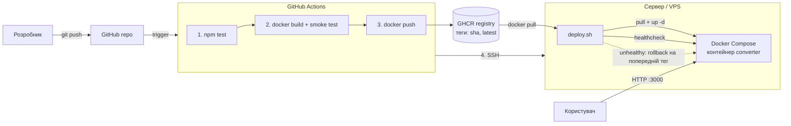

# Unit Converter — міні-проєкт з CI/CD

REST API на Node.js для конвертації валют та одиниць (довжина, маса, температура, валюти) з повним DevOps-циклом: тести → Docker-образ → реєстр GHCR → автодеплой → автоматичний відкат.

## 1. Архітектура



## 2. Технології та обґрунтування

| Інструмент | Навіщо | Чому саме він |
|---|---|---|
| Node.js 20 + Express | Сам застосунок | Мінімум коду, вбудований тест-раннер `node:test` — без зайвих залежностей |
| Docker (multi-stage, non-root) | Упаковка | Однакове середовище всюди, малий образ (alpine), безпека (`USER node`) |
| Docker Compose | Запуск і політика перезапуску | Один файл описує порт, healthcheck, `restart` |
| GitHub Actions | CI/CD | Вбудований у GitHub, безкоштовний, не потребує окремого сервера |
| GHCR | Реєстр образів | Інтегрований з GitHub, авторизація через `GITHUB_TOKEN` |
| Bash (`deploy.sh`) | Деплой + rollback | Простіше за Kubernetes/Ansible, зрозуміло з першого прочитання |
| Тегування образів за `git sha` | Версіонування | Кожен реліз відстежується до коміту, відкат = запуск старого тегу |

## 4. Структура репозиторію

```
.
├── .github/workflows/ci-cd.yml   # пайплайн: test → build → push → deploy
├── src/
│   ├── server.js                 # запуск, graceful shutdown
│   ├── app.js                    # Express-маршрути і обробка помилок
│   ├── converter.js              # логіка конвертації
│   └── rates.json                # статичні курси валют (демо)
├── test/                         # unit- та HTTP-тести (node:test)
├── scripts/
│   ├── deploy.sh                 # деплой за тегом + автоматичний rollback
│   └── rollback.sh               # ручний відкат на попередню версію
├── Dockerfile                    # multi-stage, non-root, HEALTHCHECK
├── docker-compose.yml            # сервіс, порт, restart, healthcheck
├── .dockerignore / .gitignore
└── package.json / package-lock.json
```

API: `GET /convert?value=10&from=usd&to=uah`, `GET /units`, `GET /health`, `GET /version`.

## 5. Команди для відтворення

**Локально (без Docker):**
```bash
npm install
npm test
npm start
curl "localhost:3000/convert?value=100&from=C&to=F"
```

**Локально в Docker:**
```bash
docker compose up -d --build
docker compose ps                      # статус має стати "healthy"
curl localhost:3000/health
```

**Налаштування CI/CD:**
```bash
# 1. Створіть репозиторій на GitHub і запуште код
git init && git add . && git commit -m "init"
git branch -M main
git remote add origin git@github.com:<USER>/unit-converter.git
git push -u origin main

# 2. На сервері (VPS з Docker) один раз:
git clone https://github.com/<USER>/unit-converter.git ~/unit-converter
# якщо образ приватний: docker login ghcr.io (або зробіть пакет публічним)

# 3. У GitHub: Settings → Secrets and variables → Actions додайте:
#    SSH_HOST, SSH_USER, SSH_KEY (приватний ключ)
# 4. Settings → Environments → створіть "production"
# 5. Будь-який наступний git push у main запускає весь пайплайн
```

## 6. CI/CD-пайплайн

Файл `.github/workflows/ci-cd.yml`, запускається на push і pull request у `main`.

1. **test** — checkout, Node 20, `npm ci`, `npm test`. Падіння тестів зупиняє пайплайн.
2. **build** — збірка образу з тегами `<sha>` і `latest`, **smoke-тест** (контейнер запускається і відповідає на `/health`), потім push у GHCR. На pull request образ збирається і перевіряється, але **не** публікується.
3. **deploy** (тільки push у main, середовище `production`) — SSH на сервер, `git pull`, `deploy.sh <sha>`.

## 7. Відмовостійкість та відкат

| Ситуація | Що відбувається |
|---|---|
| Падіння процесу/контейнера | `restart: unless-stopped` — Docker піднімає контейнер автоматично |
| Контейнер завис (процес живий, не відповідає) | `HEALTHCHECK` кожні 10 с; після 3 невдач статус `unhealthy` |
| Тести не пройшли | Образ не збирається і не деплоїться |
| Образ не стартує у CI | Smoke-тест падає, push не виконується |
| Новий реліз `unhealthy` на сервері | `deploy.sh` чекає до 60 с, потім **автоматично** запускає попередній тег (`.deploy_state/current`) і завершується з помилкою, тож job у GitHub червоний |
| Потрібен відкат пізніше | `./scripts/rollback.sh` (повертає на `previous`) або `./scripts/deploy.sh <будь-який-старий-sha>` |

**Перевірка відкату вручну:** зламайте `/health` (наприклад, `res.status(500)` у `src/app.js`), запуште — деплой впаде, а `curl localhost:3000/health` на сервері далі відповідатиме від старої версії.

**Бекапи:** застосунок **не має бази даних** і не зберігає стан. Курси валют лежать у `src/rates.json` під контролем Git, а кожна версія образу — у GHCR за тегом `sha`. Тому «бекап» — це історія Git + образи в реєстрі, а відновлення — повторний деплой потрібного тегу.
